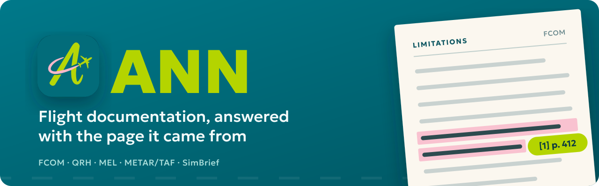
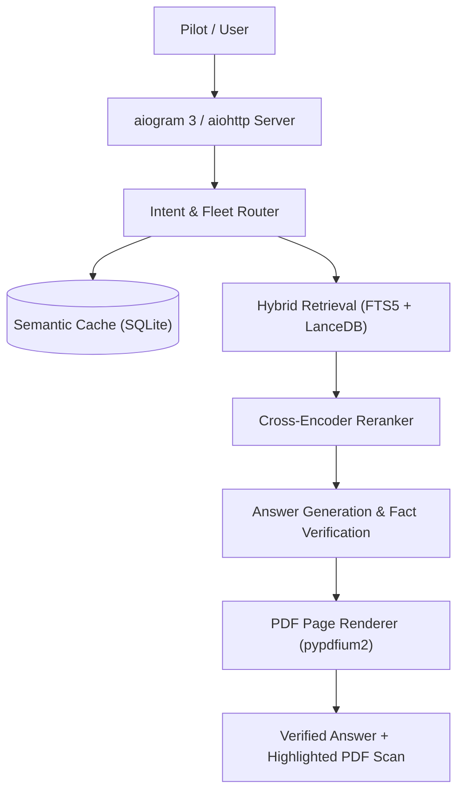

  

  [ English | <a href="README.ru.md">Русский</a> ] ·
  <a href="https://t.me/pilotann_bot">Telegram (@pilotann_bot)</a> ·
  <a href="https://ann.pilotarbuza.com">Web App (ann.pilotarbuza.com)</a> ·
  <a href="docs/ARCHITECTURE.md">Architecture</a> ·
  <a href="docs/ROADMAP.md">Roadmap</a>

ANN looks things up in civil aviation flight documentation: FCOM, QRH, MEL and the Russian FAP rules. You ask a question, it finds the right section of the manufacturer's manual with hybrid search (SQLite FTS5 plus LanceDB), checks every number and limit against the manual text and highlights the quoted line on the actual PDF page.

It runs as a Telegram bot and as a web app (PWA) at [ann.pilotarbuza.com](https://ann.pilotarbuza.com).

## What it does

- Searches manuals two ways at once: full text (SQLite FTS5 with the Snowball stemmer) and vectors (LanceDB with multilingual-e5-base). The two result lists are merged with Reciprocal Rank Fusion.
- Shows the source: pypdfium2 renders the manual page and the quoted sentence gets a highlight.
- Covers Airbus (A320 family, A330, A350), Boeing (737, 777, 787), Superjet 100, ATR 42/72, Embraer, CRJ, Dash 8, L-410 and light aircraft.
- Parses METAR and TAF and works out crosswind, headwind and tailwind for each runway from its magnetic heading.
- Imports SimBrief flight plans (OFP): route, cruise level, fuel, zero-fuel weight, alternates.
- Searches the Russian Federal Aviation Rules (FAP 128, 293, 10, 147) and Russian air law.

## Architecture

Design, formulas and data flow are in [docs/ARCHITECTURE.md](docs/ARCHITECTURE.md).

Each query is sorted by aircraft type, airline SOPs and whether it touches the Limitations section. FTS5 catches exact terms, acronyms and failure codes; LanceDB finds sections that mean the same thing in other words. Before an answer goes out, it is checked against the source text, and any number or claim the manual doesn't confirm is removed.

## Stack

- Backend: Python 3.10+, aiogram 3, aiohttp, Redis 7
- Search and storage: LanceDB, SQLite FTS5, sentence-transformers (`multilingual-e5-base`)
- PDF and images: pypdfium2, Pillow
- Frontend: Vanilla JS (ES2022), MapLibre GL, Web Push (VAPID), PWA Service Worker
- Sign-in: Telegram WebApp HMAC-SHA256, Google OAuth, Apple ID (PyJWT)

## Access

- Telegram bot: [@pilotann_bot](https://t.me/pilotann_bot)
- Web app: [ann.pilotarbuza.com](https://ann.pilotarbuza.com)

## Author

Maksim Akhmadulin ([pilotarbuza.com](https://pilotarbuza.com))  
Telegram: [@pilot_arbuza](https://t.me/pilot_arbuza)  
Email: akhmadulinmaksim@gmail.com
