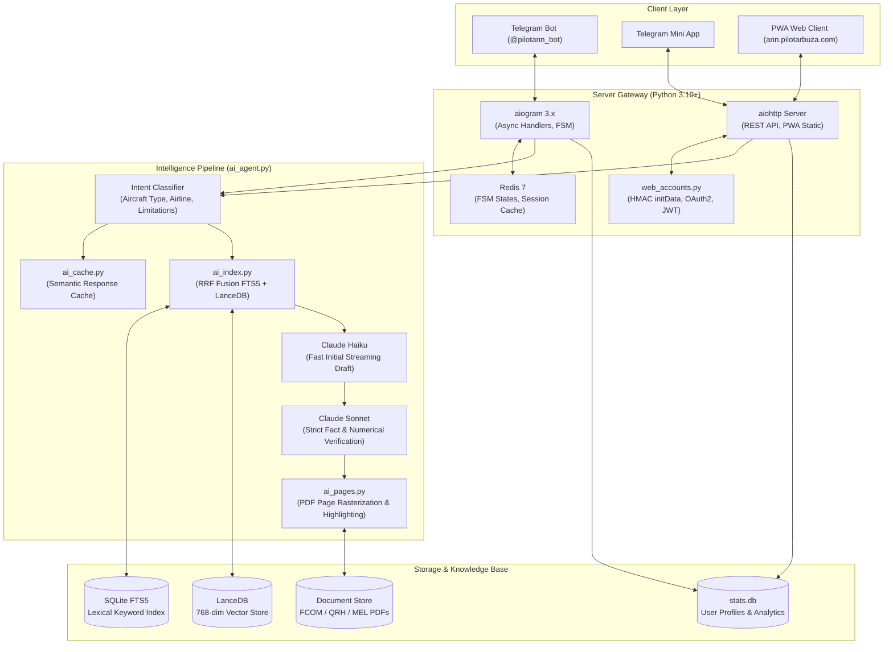

<p align="center">
  
</p>

<p align="center">
  <strong>Specialized AI Flight Deck & Aviation Documentation Assistant</strong><br>
  Hybrid RAG search across FCOM, QRH, MEL, and Aviation Regulations • Verified PDF Page Citations • METAR/TAF Decoder • SimBrief OFP Integration • Telegram Mini App & PWA
</p>

<p align="center">
  [ English | <a href="README.ru.md">Русский</a> ] ·
  <a href="https://t.me/pilotann_bot"><strong>Telegram Bot (@pilotann_bot)</strong></a> ·
  <a href="https://ann.pilotarbuza.com"><strong>Web Application (ann.pilotarbuza.com)</strong></a> ·
  <a href="docs/ARCHITECTURE.md"><strong>Architecture &amp; RAG</strong></a> ·
  <a href="docs/ROADMAP.md"><strong>Roadmap</strong></a> ·
  <a href="https://pilotarbuza.com"><strong>Author Portfolio</strong></a>
</p>

---

## Overview

**ANN (pilotann)** is an intelligent flight deck documentation assistant engineered for airline pilots, flight cadets, dispatchers, and aerospace engineers. It solves a fundamental operational challenge in civil aviation: **rapid, error-free retrieval of precise limitations, operational procedures, and performance data from multi-thousand-page aircraft manuals (FCOM, QRH, FCTM, WBM, MEL)**.

Standard general-purpose LLMs are prone to hallucinations and lack awareness of specific airline Standard Operating Procedures (SOPs). ANN addresses this through:

1. **Zero Hallucination Protocol**: Every factual claim is cross-checked against source documentation. Unverifiable assertions are rejected.
2. **Visual Citation Verification**: Renders the exact page scan of the original manufacturer PDF with an overlaid highlight on the referenced clause.
3. **Airline & Fleet Differentiation**: Differentiates between airline-specific configurations (Aeroflot, S7 Airlines, Rossiya, Pobeda, Utair, etc.) and aircraft types.
4. **Flight Operations Tooling**: Integrated METAR/TAF weather decoder with magnetic runway crosswind calculations and SimBrief Operational Flight Plan (OFP) parsing.

The service is available as a **Telegram Bot** and as an offline-capable **Progressive Web App (PWA) / Telegram Mini App** at [ann.pilotarbuza.com](https://ann.pilotarbuza.com).

---

## Core Capabilities

```
                      ┌────────────────────────────────────────┐
                      │          ANN Aviation Engine           │
                      └──────────────────┬─────────────────────┘
                                         │
     ┌───────────────────────┬───────────┴───────────┬───────────────────────┐
     ▼                       ▼                       ▼                       ▼
  Hybrid RAG            PDF Highlighting       METAR / TAF            SimBrief OFP
 • LanceDB (Vector)    • pypdfium2 engine     • ICAO regex parser    • Flight plan import
 • SQLite FTS5 (BM25)  • Bounding-box match   • Crosswind calc       • Fuel, ZFW, alternates
 • Reciprocal Rank     • Pillow visual scan   • Runway condition     • Waypoints & winds
```

- **Hybrid RAG Pipeline**: Combines dense semantic vector retrieval via LanceDB (`multilingual-e5-base`) with lexical search via SQLite FTS5 (Snowball morphological stemmer) using Reciprocal Rank Fusion (RRF).
- **Fleet Coverage**: Airbus (A220, A310, A320ceo/neo Family, A330, A340, A350, A380), Boeing (737CL/NG/MAX, 747, 757, 767, 777, 787), Superjet 100, ATR 42/72, Embraer E-Jets, CRJ Series, Dash 8 / Q400, L-410, Diamond DA40/42, Cessna 172.
- **Aviation Meteorology**: Decodes real-time METAR and TAF reports, computes headwind/crosswind/tailwind components based on actual runway magnetic headings.
- **SimBrief Dispatch Integration**: Parses operational flight plans (OFP), extracting cruising altitudes, fuel contingency, zero-fuel weight (ZFW), center of gravity limits, and alternate aerodromes.
- **Regulatory Frameworks**: Built-in indexing of ICAO Annexes, FAA Regulations, and Russian Federal Aviation Regulations (FAP-128, FAP-293, FAP-10, FAP-147).
- **Standalone PWA & Mini App**: Responsive client supporting Telegram Login, Google Sign-In, Apple ID, and Web Push notifications.

---

## System Architecture

> [!NOTE]
> For the comprehensive mathematical formulations of the RRF fusion algorithm, LanceDB vector indexing, and cryptographic authentication specifications, refer to **[docs/ARCHITECTURE.md](docs/ARCHITECTURE.md)**.

### Component Interaction Flow



---

### Request Execution Lifecycle

1. **Routing and Classification (`ai_agent.py`)**:
   Incoming queries are evaluated for aircraft type, operator specifics, and limitation tags (*Limitations*). If no aircraft type is specified, the user profile default is applied (`/type`).
2. **Semantic Cache Evaluation (`ai_cache.py`)**:
   Identical or semantically matching queries are served from the local cache in `stats.db` with sub-10ms latency.
3. **Dual-Channel Retrieval (`ai_index.py`)**:
   - **FTS5 Lexical Channel**: Performs exact keyword and abbreviation matching with morphological stemming (`snowballstemmer`).
   - **Vector Semantic Channel**: [LanceDB](https://lancedb.com/) retrieves semantically related document chunks using 768-dimensional embeddings from `intfloat/multilingual-e5-base`.
4. **Reciprocal Rank Fusion (RRF)**:
   Scores from both retrieval channels are normalized and fused using RRF ($k=60$).
5. **Cross-Encoder Neural Reranking**:
   The top 20 candidate passages are re-scored by a Cross-Encoder model across a 0 to 3 relevance spectrum.
6. **Two-Stage Generation and Strict Verification**:
   - Fast Model (Claude Haiku) generates an immediate streaming draft.
   - Deep Verifier (Claude Sonnet) executes fact-checking: cross-examining every limitation, numerical tolerance, and unit against source chunks. If a claim cannot be verified from the retrieved context, it is pruned.
7. **Visual Citation Generation (`ai_pages.py`)**:
   The engine locates the original manual page, renders it via `pypdfium2`, and composites a semi-transparent highlight marker over the exact citation text (`Pillow`).

---

## Technology Stack

Every library and engine was selected based on strict criteria: operational reliability, zero-overhead embedded architecture, and minimal latency:

| Component | Library / Tool | Role in Architecture |
|---|---|---|
| **Bot Gateway** | `aiogram 3.x` | Modern asynchronous Telegram Bot API framework with native FSM and Telegram Mini App support. |
| **Vector Engine** | `LanceDB` | Serverless, columnar vector database built on Rust/Arrow with low disk-read overhead. |
| **Embeddings** | `sentence-transformers` | On-premise execution of `intfloat/multilingual-e5-base` for robust bilingual English/Russian technical parsing. |
| **PDF Rendering** | `pypdfium2` | High-performance Google PDFium wrapper for sub-50ms page rasterization with low memory footprint. |
| **Image Processing** | `Pillow` | Visual coordinate mapping and semi-transparent bounding-box highlights over PDF page scans. |
| **HTTP Gateway** | `aiohttp` | Async web server hosting REST APIs, static assets, and external flight service integrations. |
| **Stemmer** | `snowballstemmer` | Morphological normalization for SQLite FTS5 queries without bulky external dictionary dependencies. |
| **Session Cache** | `redis` | FSM dialogue state storage, rate limiting, and request deduplication. |
| **Authentication** | `PyJWT[crypto]` | Cryptographic verification of Telegram initData (HMAC-SHA256) and Google/Apple OAuth2 tokens. |
| **LLM Gateway** | `OpenAI SDK` | Unified API integration layer connecting Claude 3.5 / GPT-4o models via low-latency endpoints. |

---

## Production Deployment & Access

The platform operates as a managed production service:

- **Telegram Bot**: Start a session via [@pilotann_bot](https://t.me/pilotann_bot).
- **Web App & PWA**: Accessible on mobile and desktop at [ann.pilotarbuza.com](https://ann.pilotarbuza.com).

For detailed engineering analysis of the RAG pipeline and cryptographic specifications, see **[docs/ARCHITECTURE.md](docs/ARCHITECTURE.md)**. For development milestones, see **[docs/ROADMAP.md](docs/ROADMAP.md)**.

---

## Security & Data Privacy

- **Zero Flight-Log Retention**: Operational flight plans (OFP) and user queries are processed in memory and never persisted to external AI training pipelines.
- **Airline Manual Confidentiality**: Proprietary airline manuals are partitioned in dedicated schema namespaces and isolated per operator authorization level.
- **Local Embedded Storage**: LanceDB and SQLite operate locally on-premise without external vector database API dependencies.

---

## Author & Contact

- **Author**: Maksim Akhmadulin ([pilotarbuza.com](https://pilotarbuza.com))
- **Telegram**: [@pilot_arbuza](https://t.me/pilot_arbuza)
- **Email**: akhmadulinmaksim@gmail.com
