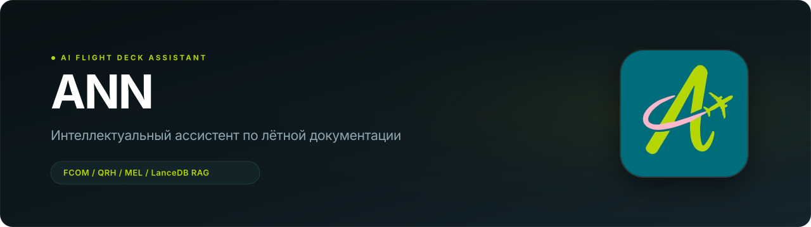
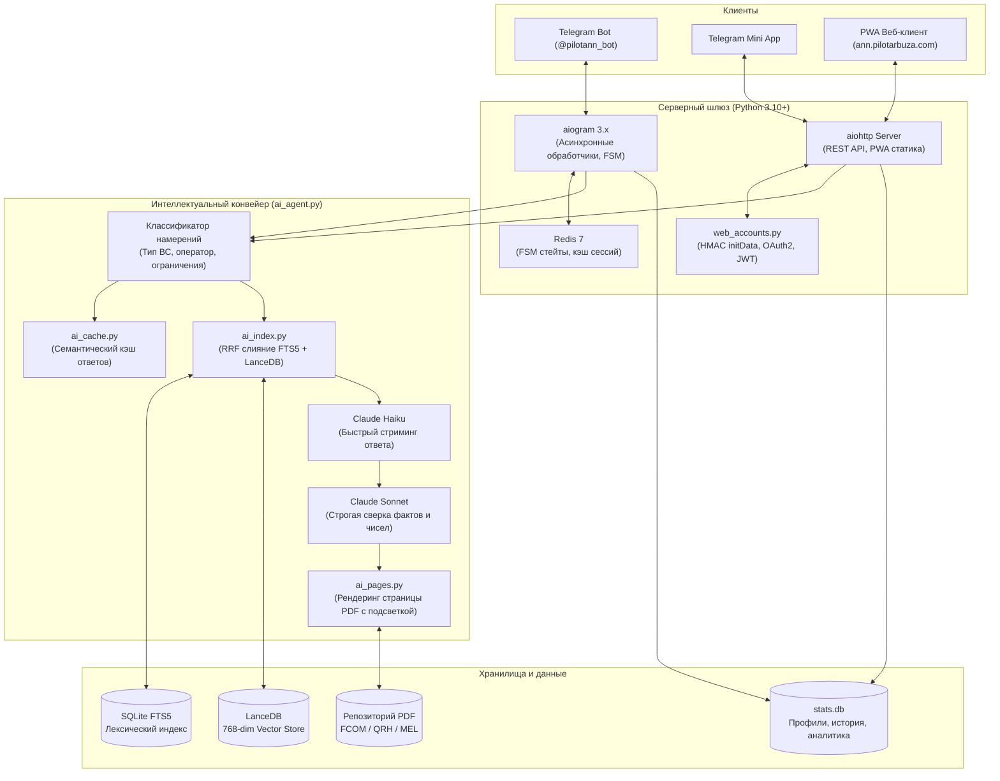

<p align="center">
  
</p>

<p align="center">
  <strong>Специализированный AI-ассистент по лётной и технической документации гражданской авиации</strong><br>
  Гибридный RAG-поиск по FCOM, QRH, MEL и ФАП • Проверка цитат со сканами PDF • Декодер METAR/TAF • SimBrief OFP • Telegram Mini App & PWA
</p>

<p align="center">
  <a href="https://t.me/pilotann_bot"><strong>🤖 Telegram-бот (@pilotann_bot)</strong></a> ·
  <a href="https://ann.pilotarbuza.com"><strong>🌐 Веб-приложение (ann.pilotarbuza.com)</strong></a> ·
  <a href="docs/ARCHITECTURE.md"><strong>Архитектура и RAG</strong></a> ·
  <a href="docs/ROADMAP.md"><strong>Планы развития</strong></a> ·
  <a href="https://pilotarbuza.com"><strong>Автор (pilotarbuza.com)</strong></a>
</p>

---

## О проекте

**ANN (pilotann)** — это интеллектуальный ассистент для пилотов, курсантов лётных училищ, диспетчеров и авиационных инженеров. Проект решает фундаментальную проблему авиационной индустрии: **быстрый и безошибочный поиск точных ограничений, процедур и параметров в многотысячестраничных руководствах по лётной эксплуатации (FCOM, QRH, FCTM, WBM, MEL)**.

В отличие от стандартных универсальных нейросетей общего назначения, ANN:
1. **Исключает галлюцинации**: ответ формируется строго на базе проверенных чанков оригинальных руководств с двухэтапной проверкой чисел, единиц измерения и логических условий.
2. **Визуально подтверждает цитату**: автоматически рендерит и обводит цитируемый фрагмент прямо на странице исходного PDF-мануала.
3. **Понимает авиационную специфику**: различает процедуры разных авиакомпаний (Аэрофлот, S7, Россия, Победа, Utair и др.) и типы ВС.
4. **Интегрирован с реальными полётными инструментами**: декодирует фактическую и прогностическую погоду (METAR/TAF), рассчитывает боковой ветер и загружает планы полёта из **SimBrief**.

Сервис работает как в виде **Telegram-бота**, так и в виде современного автономного **PWA / Telegram Mini App** на [ann.pilotarbuza.com](https://ann.pilotarbuza.com).

---

## Ключевой функционал

```
                      ┌────────────────────────────────────────┐
                      │          ANN Aviation Engine           │
                      └──────────────────┬─────────────────────┘
                                         │
     ┌───────────────────────┬───────────┴───────────┬───────────────────────┐
     ▼                       ▼                       ▼                       ▼
 🔍 Hybrid RAG         📑 PDF Highlighting    🌤️ METAR / TAF        📋 SimBrief OFP
 • LanceDB (Vector)    • pypdfium2 engine     • ICAO regex parser   • Flight plan import
 • SQLite FTS5 (BM25)  • Bounding-box match   • Crosswind calc      • Fuel, ZFW, alternates
 • Reciprocal Rank     • Pillow visual scan   • Runway condition    • Waypoints & winds
```

- **Гибридный RAG-поиск**: объединение векторных эмбеддингов `multilingual-e5-base` (LanceDB) и лексического индекса (SQLite FTS5 с морфологическим стеммером Snowball) по формуле RRF.
- **Поддержка флота**: Airbus (A220, A310, A320 Family, A330, A340, A350, A380), Boeing (737CL/NG/MAX, 747, 757, 767, 777, 787), Superjet 100, ATR 42/72, Embraer, CRJ, Dash 8, L-410, Diamond DA40/42, Cessna 172.
- **Авиационная метеорология**: расшифровка сводок погоды METAR и TAF с расчётом встречной/боковой составляющей ветра по магнитным курсам полос.
- **Интеграция с SimBrief**: парсинг расчетного плана полета (OFP) — эшелон полета, расчет топлива, центровка, загрузка и запасные аэродромы.
- **Нормативно-правовая база РФ**: встроенный поиск по актуальным Федеральным авиационным правилам (ФАП-128, ФАП-293, ФАП-10, ФАП-147) и Воздушному кодексу РФ.
- **Автономное PWA / Telegram Mini App**: быстрый веб-интерфейс с поддержкой авторизации через Telegram, Google, Apple ID и Web Push-уведомлений.

---

## Подробное техническое описание и архитектура

> [!NOTE]
> Полный математический и алгоритмический разбор RAG-движка, формулы слияния рангов и криптографии авторизации вынесен в отдельный документ: **[docs/ARCHITECTURE.md](docs/ARCHITECTURE.md)**.

### Как взаимодействуют компоненты системы



### Жизненный цикл обработки запроса пилота

1. **Маршрутизация и классификация (`ai_agent.py`)**:
   Запрос анализируется на упоминание конкретного воздушного судна, авиакомпании и признака раздела ограничений (*Limitations*). Если тип ВС не указан явно, бот берёт значение из сохранённого профиля пилота (`/type`).
2. **Проверка семантического кэша (`ai_cache.py`)**:
   Повторяющиеся типовые запросы отдаются мгновенно из локального кэша `stats.db`.
3. **Двухканальное извлечение фрагментов (`ai_index.py`)**:
   - **FTS5-канал**: осуществляет точный лексический поиск с морфологическим стеммингом (`snowballstemmer`), вылавливая аббревиатуры и коды отказов.
   - **Векторный канал**: [LanceDB](https://lancedb.com/) ищет семантически близкие чанки по векторным эмбеддингам модели `intfloat/multilingual-e5-base`.
4. **Слияние рангов Reciprocal Rank Fusion (RRF)**:
   Оценки обоих каналов объединяются, нивелируя недостатки каждого метода в отдельности.
5. **Нейросетевой реранкинг**:
   Топ-20 результатов переоцениваются Cross-Encoder реранкером по шкале релевантности от 0 до 3.
6. **Двухэтапная генерация (Haiku + Sonnet)**:
   - Быстрая модель (Claude Haiku) мгновенно начинает отдавать черновик ответа пользователю.
   - Сильная модель (Claude Sonnet) параллельно проводит верификацию: сверяет каждое числовое значение, ограничения и сноски с оригинальным текстом чанков. Если модель не находит прямого подтверждения факту — утверждение отсекается.
7. **Формирование визуального подтверждения (`ai_pages.py`)**:
   Движок обращается к оригинальному PDF-файлу руководства, с помощью `pypdfium2` мгновенно растеризует страницу нужного раздела и накладывает полупрозрачную маркерную плашку поверх цитируемого фрагмента (`Pillow`). Пользователь получает ответ вместе с фото фрагмента мануала.

---

## Стек технологий и библиотека зависимостей

Каждая библиотека в проекте выбрана с учётом строгих требований к отказоустойчивости, минимальной задержке и ресурсоёмкости:

| Библиотека | Роль в системе | Обоснование выбора |
|---|---|---|
| **`aiogram 3.x`** | Асинхронный Telegram Bot API | Стандарт современной асинхронной разработки ботов на Python с поддержкой FSM, роутеров и нативных Telegram Mini Apps. |
| **`LanceDB`** | Векторная база данных | Встраиваемая (serverless) колоночная векторная СУБД на Rust/Arrow. Работает без отдельного фонового демона и обеспечивает минимальное время отклика на диске. |
| **`sentence-transformers`** | Генерация эмбеддингов | Локальный запуск модели `multilingual-e5-base`, обеспечивающей превосходное качество понимания русско- и англоязычных авиационных текстов. |
| **`pypdfium2`** | Движок рендеринга PDF | Основан на движке Google PDFium. Растеризует страницы PDF в разы быстрее традиционных утилит (poppler/pdf2image) при минимальном потреблении оперативной памяти. |
| **`Pillow`** | Обработка изображений | Наложение графической подсветки (bounding box highlight) на отсканированные страницы и оптимизация изображений для отправки в чат. |
| **`aiohttp`** | Web-сервер и HTTP-клиент | Легковесный асинхронный сервер, обслуживающий REST API веб-приложения, раздачу статики и внешние вызовы к API метеорологии и SimBrief. |
| **`snowballstemmer`** | Морфологический анализ | Быстрый стеммер без внешних тяжелых словарей, обеспечивающий качественную нормализацию поисковых запросов в SQLite FTS5. |
| **`redis`** | Кэш и сессии FSM | Хранение промежуточных состояний диалога, управление очередями и блокировка повторных спам-запросов. |
| **`PyJWT[crypto]`** | Аутентификация | Криптографическая валидация токенов авторизации Google Sign-In и Apple ID для PWA-версии. |
| **`OpenAI SDK`** | Клиент нейросетей | Работа с моделями Claude / GPT через единый высокопроизводительный шлюз OpenRouter API. |

---

## Запуск и использование

Проект развёрнут в виде готового сервиса:
- **Telegram-бот**: запустить диалог можно по ссылке [@pilotann_bot](https://t.me/pilotann_bot).
- **Веб-приложение и PWA**: доступно в браузере или на мобильных устройствах по адресу [ann.pilotarbuza.com](https://ann.pilotarbuza.com).

Для знакомства с деталями архитектуры обратитесь к файлу [docs/ARCHITECTURE.md](docs/ARCHITECTURE.md). План развития и предстоящие релизы зафиксированы в [docs/ROADMAP.md](docs/ROADMAP.md).

---

## Контакты и авторство

- **Автор проекта**: Максим Ахмадулин ([pilotarbuza.com](https://pilotarbuza.com))
- **Telegram**: [@pilot_arbuza](https://t.me/pilot_arbuza)
- **Email**: akhmadulinmaksim@gmail.com
