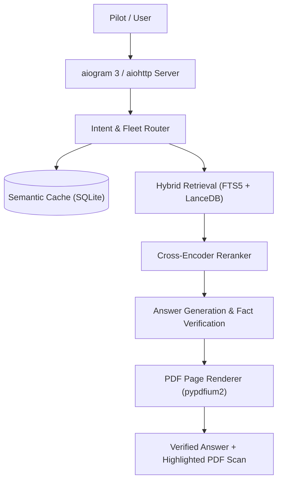

  

  [ English | <a href="README.ru.md">Русский</a> ] ·
  <a href="https://t.me/pilotann_bot">Telegram (@pilotann_bot)</a> ·
  <a href="https://ann.pilotarbuza.com">Web App (ann.pilotarbuza.com)</a> ·
  <a href="docs/ARCHITECTURE.md">Architecture</a> ·
  <a href="docs/ROADMAP.md">Roadmap</a>

---

ANN is a search and reference tool for civil aviation flight documentation (FCOM, QRH, MEL, FAP). It takes a pilot's question, finds the relevant section in manufacturer manuals via hybrid search (SQLite FTS5 + LanceDB), verifies numbers and limits against the manual text, and highlights the cited line directly on the rendered PDF page.

The service is available as a Telegram bot and as a standalone web app / PWA at [ann.pilotarbuza.com](https://ann.pilotarbuza.com).

## What it does

- **Manual search**: hybrid retrieval combining full-text search (SQLite FTS5 with Snowball stemmer) and vector search (LanceDB + multilingual-e5-base) merged with Reciprocal Rank Fusion (RRF).
- **PDF page verification**: renders the source manual page using pypdfium2 and overlays a highlight on the exact cited sentence.
- **Fleet manuals**: Airbus (A320 family, A330, A350), Boeing (737, 777, 787), Superjet 100, ATR 42/72, Embraer, CRJ, Dash 8, L-410, light aircraft.
- **Weather**: METAR and TAF parser with runway crosswind, headwind, and tailwind calculations based on magnetic headings.
- **SimBrief**: imports Operational Flight Plans (OFP) — route, cruise altitude, fuel calculation, zero-fuel weight, alternates.
- **Regulations**: search across Russian Federal Aviation Rules (FAP 128, 293, 10, 147) and air law.

## Architecture

Detailed design, formulas, and data flow: [docs/ARCHITECTURE.md](docs/ARCHITECTURE.md).

Queries are classified by aircraft type, airline SOPs, and limitation sections. FTS5 handles exact terms, acronyms, and failure codes, while LanceDB retrieves semantically similar sections. Generated answers are checked against the source text — unconfirmed numbers or claims are dropped before sending.

## Tech Stack

- **Backend**: Python 3.10+, aiogram 3, aiohttp, Redis 7
- **Search & Storage**: LanceDB, SQLite FTS5, sentence-transformers (`multilingual-e5-base`)
- **PDF & Graphics**: pypdfium2, Pillow
- **Frontend**: Vanilla JS (ES2022), MapLibre GL, Web Push (VAPID), PWA Service Worker
- **Auth**: Telegram WebApp HMAC-SHA256, Google OAuth, Apple ID (PyJWT)

## Access

- Telegram bot: [@pilotann_bot](https://t.me/pilotann_bot)
- Web version: [ann.pilotarbuza.com](https://ann.pilotarbuza.com)

## Author

Maksim Akhmadulin ([pilotarbuza.com](https://pilotarbuza.com))  
Telegram: [@pilot_arbuza](https://t.me/pilot_arbuza)  
Email: akhmadulinmaksim@gmail.com
