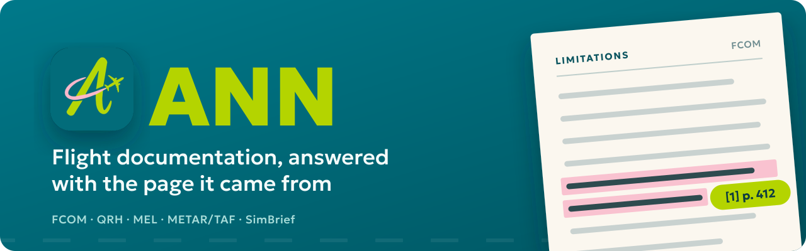
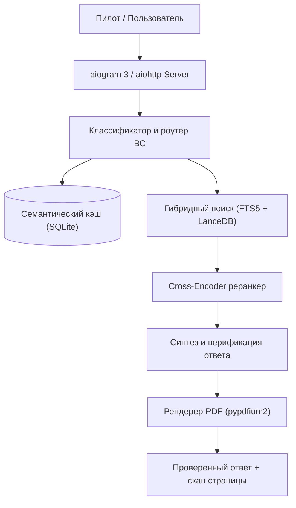

  

  [ <a href="README.md">English</a> | Русский ] ·
  <a href="https://t.me/pilotann_bot">Telegram (@pilotann_bot)</a> ·
  <a href="https://ann.pilotarbuza.com">Веб-приложение (ann.pilotarbuza.com)</a> ·
  <a href="docs/ARCHITECTURE.ru.md">Архитектура</a> ·
  <a href="docs/ROADMAP.ru.md">Планы</a>

ANN ищет ответы в летной документации гражданской авиации: FCOM, QRH, MEL и ФАП. Пилот задает вопрос, бот находит нужный раздел руководства гибридным поиском (SQLite FTS5 и LanceDB), сверяет числа и ограничения с текстом мануала и подсвечивает цитату прямо на странице исходного PDF.

Есть Telegram-бот и веб-приложение (PWA) на [ann.pilotarbuza.com](https://ann.pilotarbuza.com).

## Что умеет

- Ищет по мануалам сразу двумя способами: полнотекстовым индексом (SQLite FTS5 со стеммером Snowball) и векторным поиском (LanceDB с multilingual-e5-base). Результаты объединяются алгоритмом RRF.
- Показывает источник: pypdfium2 рисует страницу мануала, а цитируемое предложение выделяется маркером.
- Знает Airbus (A320 family, A330, A350), Boeing (737, 777, 787), Superjet 100, ATR 42/72, Embraer, CRJ, Dash 8, L-410 и легкие ВС.
- Разбирает METAR и TAF и считает боковую, встречную и попутную составляющие ветра по магнитным курсам ВПП.
- Загружает план полета SimBrief (OFP): маршрут, эшелон, топливо, центровку, запасные.
- Ищет по Федеральным авиационным правилам (ФАП-128, ФАП-293, ФАП-10, ФАП-147) и воздушному законодательству РФ.

## Архитектура

Подробное устройство, формулы и схема данных описаны в [docs/ARCHITECTURE.ru.md](docs/ARCHITECTURE.ru.md).

Сначала запрос раскладывается по типу ВС, авиакомпании и признаку ограничений (Limitations). FTS5 находит аббревиатуры и коды отказов, LanceDB находит разделы, близкие по смыслу. Готовый ответ сверяется с исходными фрагментами документации, и числа или параметры, которых там нет, из него убираются.

## Стек

- Бэкенд: Python 3.10+, aiogram 3, aiohttp, Redis 7
- Поиск и базы: LanceDB, SQLite FTS5, sentence-transformers (`multilingual-e5-base`)
- PDF и графика: pypdfium2, Pillow
- Фронтенд: Vanilla JS (ES2022), MapLibre GL, Web Push (VAPID), PWA Service Worker
- Авторизация: Telegram WebApp HMAC-SHA256, Google OAuth, Apple ID (PyJWT)

## Где найти

- Telegram-бот: [@pilotann_bot](https://t.me/pilotann_bot)
- Веб-версия: [ann.pilotarbuza.com](https://ann.pilotarbuza.com)

## Автор

Максим Ахмадулин ([pilotarbuza.com](https://pilotarbuza.com))  
Telegram: [@pilot_arbuza](https://t.me/pilot_arbuza)  
Email: akhmadulinmaksim@gmail.com
