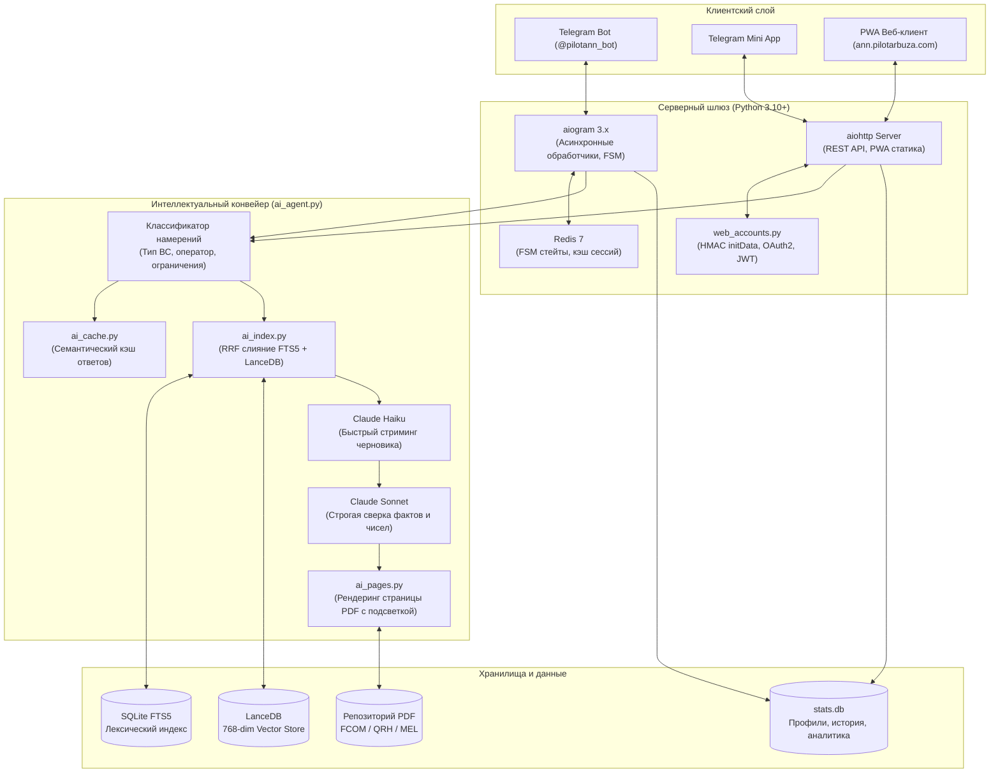

<p align="center">
  
</p>

<p align="center">
  <strong>Специализированный AI-ассистент по лётной и технической документации гражданской авиации</strong><br>
  Гибридный RAG-поиск по FCOM, QRH, MEL и нормативным актам • Проверка цитат со сканами PDF • Декодер METAR/TAF • SimBrief OFP • Telegram Mini App & PWA
</p>

<p align="center">
  [ <a href="README.md">English</a> | Русский ] ·
  <a href="https://t.me/pilotann_bot"><strong>Telegram-бот (@pilotann_bot)</strong></a> ·
  <a href="https://ann.pilotarbuza.com"><strong>Веб-приложение (ann.pilotarbuza.com)</strong></a> ·
  <a href="docs/ARCHITECTURE.ru.md"><strong>Архитектура и RAG</strong></a> ·
  <a href="docs/ROADMAP.ru.md"><strong>Планы развития</strong></a> ·
  <a href="https://pilotarbuza.com"><strong>Сайт автора</strong></a>
</p>

---

## О проекте

**ANN (pilotann)** — специализированный интеллектуальный ассистент для действующих пилотов авиакомпаний, курсантов лётных училищ, диспетчеров и авиационных инженеров. Проект решает ключевую практическую задачу гражданской авиации: **быстрый и безошибочный поиск точных эксплуатационных ограничений, процедур и параметров в многотысячестраничных руководствах по лётной эксплуатации (FCOM, QRH, FCTM, WBM, MEL)**.

Обычные универсальные языковые модели склонны к галлюцинациям и не учитывают специфику стандартных эксплуатационных процедур (SOP) авиакомпаний. ANN решает эту проблему:

1. **Протокол нулевых галлюцинаций**: каждый факт и числовое значение сверяются с первоисточником. Утверждения без прямого подтверждения в документации отсекаются.
2. **Визуальное подтверждение цитат**: система автоматически растеризует страницу оригинального PDF-руководства производителя и накладывает маркерную плашку на цитируемый пункт.
3. **Учёт специфики авиакомпаний**: разделение процедур по типам ВС и конкретным эксплуатантам (Аэрофлот, S7 Airlines, Россия, Победа, Utair и др.).
4. **Инструменты лётной практики**: декодирование сводок погоды METAR/TAF с вычислением бокового ветра по полосам и загрузка планов полёта из SimBrief.

Сервис доступен в виде **Telegram-бота** и автономного кроссплатформенного **PWA / Telegram Mini App** на [ann.pilotarbuza.com](https://ann.pilotarbuza.com).

---

## Ключевой функционал

```
                      ┌────────────────────────────────────────┐
                      │          ANN Aviation Engine           │
                      └──────────────────┬─────────────────────┘
                                         │
     ┌───────────────────────┬───────────┴───────────┬───────────────────────┐
     ▼                       ▼                       ▼                       ▼
   Hybrid RAG           PDF Highlighting       METAR / TAF            SimBrief OFP
 • LanceDB (Vector)    • pypdfium2 engine     • ICAO regex parser    • Flight plan import
 • SQLite FTS5 (BM25)  • Bounding-box match   • Crosswind calc       • Fuel, ZFW, alternates
 • Reciprocal Rank     • Pillow visual scan   • Runway condition     • Waypoints & winds
```

- **Гибридный RAG-поиск**: объединение векторных эмбеддингов `multilingual-e5-base` (LanceDB) и лексического индекса (SQLite FTS5 со стеммером Snowball) по алгоритму Reciprocal Rank Fusion (RRF).
- **Поддержка типов ВС**: Airbus (A220, A310, A320ceo/neo Family, A330, A340, A350, A380), Boeing (737CL/NG/MAX, 747, 757, 767, 777, 787), Superjet 100, ATR 42/72, Embraer E-Jets, CRJ Series, Dash 8 / Q400, L-410, Diamond DA40/42, Cessna 172.
- **Авиационная метеорология**: расшифровка сводок METAR и TAF с расчётом встречной и боковой составляющих ветра по магнитным курсам ВПП.
- **Интеграция с SimBrief**: парсинг расчетного плана полета (OFP) — эшелоны, топливные расчеты, центровка, загрузка и запасные аэродромы.
- **Нормативная база**: встроенный поиск по актуальным Федеральным авиационным правилам (ФАП-128, ФАП-293, ФАП-10, ФАП-147), Воздушному кодексу РФ и стандартам ICAO/FAA.
- **Автономное PWA / Telegram Mini App**: веб-интерфейс с поддержкой авторизации через Telegram, Google, Apple ID и Web Push-уведомлений.

---

## Архитектура системы

> [!NOTE]
> Полный математический анализ RAG-движка, формулы слияния рангов и криптография авторизации вынесены в отдельный документ: **[docs/ARCHITECTURE.ru.md](docs/ARCHITECTURE.ru.md)**.

### Схема взаимодействия компонентов



---

### Жизненный цикл обработки запроса

1. **Маршрутизация и классификация (`ai_agent.py`)**:
   Запрос анализируется на упоминание конкретного воздушного судна, авиакомпании и признака раздела ограничений (*Limitations*). Если тип ВС не указан, применяется значение из профиля пользователя (`/type`).
2. **Семантический кэш (`ai_cache.py`)**:
   Повторяющиеся запросы отдаются мгновенно из локального кэша `stats.db`.
3. **Двухканальное извлечение (`ai_index.py`)**:
   - **FTS5-канал**: осуществляет точный лексический поиск с морфологическим стеммингом (`snowballstemmer`), вылавливая аббревиатуры и коды отказов.
   - **Векторный канал**: [LanceDB](https://lancedb.com/) извлекает контекст по векторным эмбеддингам модели `intfloat/multilingual-e5-base`.
4. **Слияние рангов Reciprocal Rank Fusion (RRF)**:
   Оценки обоих каналов объединяются, нивелируя недостатки каждого метода в отдельности.
5. **Нейросетевой реранкинг**:
   Топ-20 результатов переоцениваются Cross-Encoder реранкером по шкале релевантности от 0 до 3.
6. **Двухэтапная генерация и сверка**:
   - Быстрая модель (Claude Haiku) начинает отдавать черновик ответа пользователю.
   - Сильная модель (Claude Sonnet) проводит верификацию: сверяет каждое числовое значение, ограничения и сноски с оригинальным текстом чанков. Если модель не находит прямого подтверждения — утверждение исключается.
7. **Формирование визуального подтверждения (`ai_pages.py`)**:
   Движок обращается к оригинальному PDF-файлу руководства, через `pypdfium2` растеризует страницу нужного раздела и накладывает полупрозрачную маркерную плашку поверх цитируемого фрагмента (`Pillow`).

---

## Стек технологий

| Компонент | Библиотека | Назначение |
|---|---|---|
| **Шлюз бота** | `aiogram 3.x` | Асинхронный фреймворк с поддержкой FSM, фильтров и нативных Telegram Mini Apps. |
| **Векторная СУБД** | `LanceDB` | Встраиваемая (serverless) колоночная векторная база данных на базе Rust/Arrow. |
| **Эмбеддинги** | `sentence-transformers` | Локальный запуск модели `multilingual-e5-base` для русско- и англоязычных текстов. |
| **Рендеринг PDF** | `pypdfium2` | Движок на базе Google PDFium для быстрой растеризации страниц с минимальным потреблением памяти. |
| **Графика** | `Pillow` | Наложение координатной подсветки на страницы и сжатие изображений для отправки в чат. |
| **Web-сервер** | `aiohttp` | Асинхронный сервер REST API, раздача статики PWA и вызовы к внешним сервисам. |
| **Стеммер** | `snowballstemmer` | Морфологическая нормализация поисковых запросов в SQLite FTS5. |
| **Кэш сессий** | `redis` | Хранение состояний диалога, очереди и ограничение частоты запросов. |
| **Аутентификация** | `PyJWT[crypto]` | Криптографическая валидация данных авторизации Telegram, Google и Apple ID. |
| **LLM-шлюз** | `OpenAI SDK` | Универсальный клиент взаимодействия с моделями Claude / GPT. |

---

## Доступ к сервису

- **Telegram-бот**: [@pilotann_bot](https://t.me/pilotann_bot).
- **Веб-приложение и PWA**: [ann.pilotarbuza.com](https://ann.pilotarbuza.com).

Подробная документация: **[docs/ARCHITECTURE.ru.md](docs/ARCHITECTURE.ru.md)**. Планы развития: **[docs/ROADMAP.ru.md](docs/ROADMAP.ru.md)**.

---

## Безопасность и конфиденциальность

- **Отсутствие логирования полётных данных**: расчетные планы полёта (OFP) и запросы экипажей обрабатываются в оперативной памяти и не сохраняются для внешнего обучения AI.
- **Изоляция мануалов авиакомпаний**: закрытые внутренние руководства операторов хранятся в изолированных схемах с разделением прав доступа.
- **Локальное хранение**: базы LanceDB и SQLite развёрнуты локально без передачи векторных индексов сторонним облачным провайдерам.

---

## Контакты и авторство

- **Автор проекта**: Максим Ахмадулин ([pilotarbuza.com](https://pilotarbuza.com))
- **Telegram**: [@pilot_arbuza](https://t.me/pilot_arbuza)
- **Email**: akhmadulinmaksim@gmail.com
