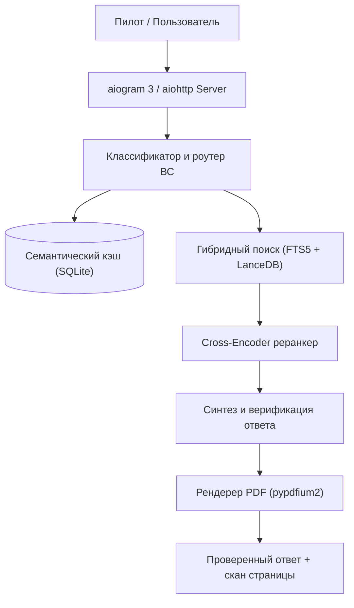

  

  [ <a href="README.md">English</a> | Русский ] ·
  <a href="https://t.me/pilotann_bot">Telegram (@pilotann_bot)</a> ·
  <a href="https://ann.pilotarbuza.com">Веб-приложение (ann.pilotarbuza.com)</a> ·
  <a href="docs/ARCHITECTURE.ru.md">Архитектура</a> ·
  <a href="docs/ROADMAP.ru.md">Планы</a>

---

ANN — поисковый и справочный инструмент по лётной документации гражданской авиации (FCOM, QRH, MEL, ФАП). Принимает вопрос пилота, находит нужный раздел в руководствах через гибридный поиск (SQLite FTS5 + LanceDB), сверяет числа и ограничения с текстом мануала и подсвечивает цитируемый пункт прямо на странице оригинального PDF.

Работает как Telegram-бот и как веб-приложение / PWA на [ann.pilotarbuza.com](https://ann.pilotarbuza.com).

## Основные возможности

- **Поиск по мануалам**: гибридный RAG-поиск — полнотекстовый индекс (SQLite FTS5 со стеммером Snowball) и векторный поиск (LanceDB + multilingual-e5-base), объединённые алгоритмом RRF.
- **Подтверждение цитат в PDF**: модуль на базе pypdfium2 растеризует страницу мануала и накладывает маркерную плашку на цитируемое предложение.
- **База самолётов**: Airbus (A320 family, A330, A350), Boeing (737, 777, 787), Superjet 100, ATR 42/72, Embraer, CRJ, Dash 8, L-410, лёгкие ВС.
- **Погода**: парсер METAR и TAF с расчётом боковой, встречной и попутной составляющих ветра по магнитным курсам ВПП.
- **SimBrief**: импорт расчетного плана полета (OFP) — маршрут, эшелон, топливо, центровка, запасные.
- **Нормативная база**: поиск по Федеральным авиационным правилам (ФАП-128, ФАП-293, ФАП-10, ФАП-147) и воздушному законодательству РФ.

## Архитектура

Подробное описание, формулы и схема данных: [docs/ARCHITECTURE.ru.md](docs/ARCHITECTURE.ru.md).

Запрос классифицируется по типу ВС, авиакомпании и признаку ограничений (Limitations). FTS5 находит аббревиатуры и коды отказов, LanceDB — близкие по смыслу разделы. Сформированный ответ проверяется по исходным фрагментам документации — неподтверждённые числа и параметры отсекаются.

## Стек технологий

- **Бэкенд**: Python 3.10+, aiogram 3, aiohttp, Redis 7
- **Поиск и базы**: LanceDB, SQLite FTS5, sentence-transformers (`multilingual-e5-base`)
- **PDF и графика**: pypdfium2, Pillow
- **Фронтенд**: Vanilla JS (ES2022), MapLibre GL, Web Push (VAPID), PWA Service Worker
- **Авторизация**: Telegram WebApp HMAC-SHA256, Google OAuth, Apple ID (PyJWT)

## Доступ к сервису

- Telegram-бот: [@pilotann_bot](https://t.me/pilotann_bot)
- Веб-версия: [ann.pilotarbuza.com](https://ann.pilotarbuza.com)

## Автор

Максим Ахмадулин ([pilotarbuza.com](https://pilotarbuza.com))  
Telegram: [@pilot_arbuza](https://t.me/pilot_arbuza)  
Email: akhmadulinmaksim@gmail.com
