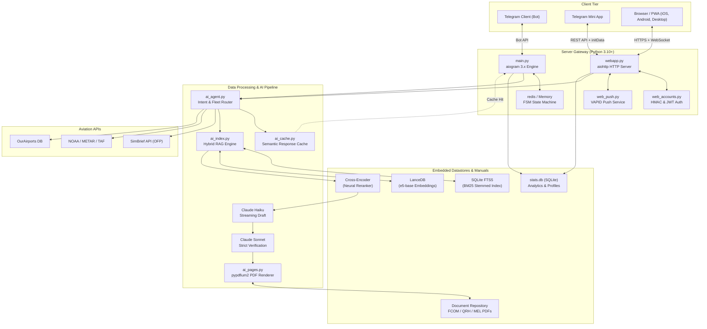
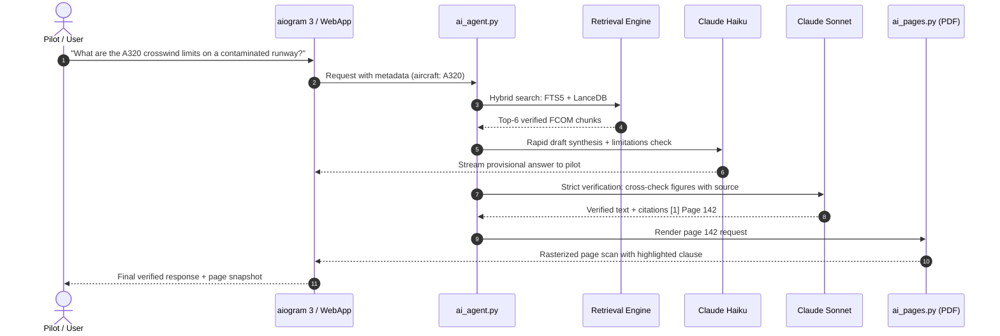

# Technical Architecture & System Design — ANN (pilotann)

[ English | [Русский](ARCHITECTURE.ru.md) ]

This document provides a comprehensive engineering description of the **ANN** architecture, the operational principles of its Hybrid Retrieval-Augmented Generation (Hybrid RAG) engine, inter-module communication topology, library dependency stack, and end-to-end data pipelines connecting clients, embedded datastores, and large language models.

---

## 1. System Topology & Inter-Module Communication

The architecture is partitioned into three decoupled tiers: **Client Tier**, **Asynchronous Server Gateway**, and the **Data Processing & AI Pipeline**.

---

## 2. Hybrid RAG Search Engine

Aviation technical documentation (FCOM, QRH, MEL) exhibits distinct structural properties:
- High density of precise alphanumeric codes, abbreviations, and numerical thresholds (`FL390`, `VMO 350`, `PACK 1 FAULT`).
- Natural-language queries submitted by pilots (*"procedure for hydraulic system B failure on final approach"*).
- Zero tolerance for hallucinated operational limits or crosswind components.

To address these requirements, ANN implements a **dual-channel retrieval architecture with Reciprocal Rank Fusion (RRF)**.

### 2.1. Lexical Keyword Index (SQLite FTS5)
- **Engine**: SQLite FTS5 extension with custom tokenization and prefix indexing.
- **Stemming**: Configured with `snowballstemmer` for Russian morphology and Porter stemming for English technical terms.
- **Scoring**: Customized BM25 ranking with boosted weights assigned to section headers (`title`), operational limitations (`limitations`), and procedural action steps (`steps`).

### 2.2. Dense Semantic Vector Index (LanceDB)
- **Engine**: High-throughput serverless columnar vector database [LanceDB](https://lancedb.com/), operating directly over disk-persisted Lance datasets without a background daemon process.
- **Embedding Model**: `intfloat/multilingual-e5-base` (768 dimensions), selected for its balanced bilingual performance across English and Russian aviation literature.
- **Distance Metric**: Cosine similarity.

### 2.3. Reciprocal Rank Fusion (RRF)
Search results from the lexical and dense vector channels are merged using reciprocal rank scoring:

$$RRF(d) = \sum_{m \in \{FTS, Vector\}} \frac{1}{k + r_m(d)}$$

Where:
- $r_m(d)$ is the ordinal rank of document $d$ in the output of retrieval channel $m$ (1-indexed).
- $k = 60$ is the standard smoothing constant, preventing single-channel outliers from dominating the blended candidate set.

### 2.4. Cross-Encoder Neural Reranking
The top 20 candidate passages from RRF fusion are evaluated by a Cross-Encoder classifier, assigning each chunk a relevance score from `0` to `3`. Passages below the confidence threshold are pruned, maximizing the signal-to-noise ratio within the generation context window.

---

## 3. Two-Stage Generation and Strict Verification

1. **Query Intent Classification**: Automatically resolves aircraft fleet type (A320, B737, SSJ100, etc.), operator-specific deviations, and limitations tags (*Limitations*).
2. **Provisional Draft (Claude Haiku)**: Generates an immediate initial stream, minimizing Time-to-First-Token (TTFT).
3. **Deep Verification (Claude Sonnet)**: Conducts factual auditing: validates every numerical figure, unit of measurement (knots, meters, feet, kilograms), and conditional logic (*"IF ... THEN"*) strictly against source text. Claims not grounded in retrieved chunks are excised.

---

## 4. Visual Citation Engine (PDF Page Renderer)

ANN pairs text answers with visual verification from official manufacturer manuals:
1. The `ai_pages.py` module accesses the authoritative PDF revision for the target fleet.
2. The page is rasterized via `pypdfium2` (high-performance Python bindings to Google PDFium) at high resolution.
3. Sentence coordinates are mapped to bounding boxes in the document text layer.
4. `Pillow` renders a semi-transparent highlight marker over the cited paragraph and generates an optimized JPEG/WebP preview for delivery to the client.

---

## 5. WebApp, PWA & Authentication Architecture

Alongside Telegram, ANN provides an independent progressive web application:

- **Frontend**: Vanilla ES2022 JavaScript, responsive dark/light flight deck CSS variables, Web App Manifest, and Service Worker (`sw.js`) for offline asset caching.
- **Cartography**: `MapLibre GL` rendering Flight Information Region (FIR) boundaries, aerodromes, and flight routes.
- **Cryptographic Multi-Auth (`web_accounts.py`)**:
  - **Telegram WebApp**: HMAC-SHA256 signature verification of `initData` using the bot token.
  - **Google OAuth / Apple ID**: Public key validation using JWKS and `PyJWT[crypto]`.
  - **Email One-Time Passwords**: 6-digit cryptographically random verification tokens with sliding rate limiting.
- **Push Delivery**: Web Push notifications over RFC 8292 VAPID with encrypted payloads.

---

## 6. Aviation Tooling & Auxiliary Integrations

- **METAR / TAF (`metar_decode.py`)**: Regular (METAR) and terminal forecast (TAF) tokenizer. Computes headwind/crosswind/tailwind components based on aerodrome runway magnetic headings, cloud layers (CB, TCU), and runway surface condition reports (RVR, contaminant depth, braking action).
- **SimBrief Parser (`simbrief.py`)**: Parses SimBrief XML/JSON Operational Flight Plans (OFP), extracting cruise levels (CRZ ALT), block fuel, zero-fuel weight (ZFW), alternate airports, routing, and waypoint wind components.
- **OurAirports DB (`airports.py`)**: Embedded SQLite index of global aerodromes: ICAO/IATA codes, elevation, runway layout, communication frequencies, and ILS/VOR navigation aids.

---

## 7. Library & Dependency Matrix

| Library | Function | Architectural Rationale |
|---|---|---|
| `aiogram>=3.4.0` | Telegram Bot Core | Fully asynchronous framework supporting Bot API 7.x, FSM filters, and native Telegram Mini Apps. |
| `lancedb>=0.20` | Vector Database | Serverless embedded database with Lance columnar format, delivering high-speed disk-backed vector retrieval. |
| `sentence-transformers>=2.4.0` | Dense Embeddings | Industry standard for executing `multilingual-e5-base` models on local CPU/GPU hardware. |
| `snowballstemmer>=2.2` | Morphological Stemmer | High-speed normalization for English and Russian lexical indexing in SQLite FTS5 without bulky dependencies. |
| `pypdfium2>=4.30` | PDF Engine | Google PDFium-based rendering (5-10x faster than poppler/pdf2image) with minimal memory footprint. |
| `pillow>=10` | Graphic Compositing | Coordinate-based highlight overlays on PDF page scans and image delivery optimization. |
| `aiohttp>=3.9.0` | Asynchronous Server | Handles REST APIs, PWA static assets, and async calls to external weather and SimBrief APIs. |
| `redis>=5.0.0` | Session & State Store | High-throughput storage for Telegram conversation states and request rate limiting. |
| `openai>=1.14.0` | LLM Gateway Client | Unified API client for OpenRouter and OpenAI-compatible inference endpoints. |
| `PyJWT[crypto]>=2.8` | Auth Cryptography | RS256/ES256 signature verification for Google Sign-In and Sign in with Apple tokens. |
| `python-dotenv>=1.0.0` | Configuration | Secure environment variable injection from `.env`. |
| `astral>=3.2` | Solar Ephemeris | Computes sunrise, sunset, and civil twilight timings across route waypoints. |
