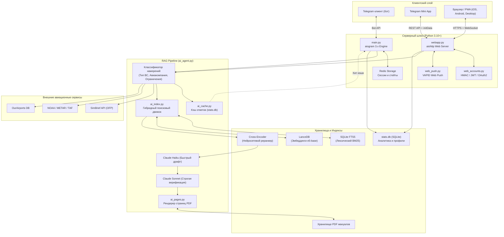
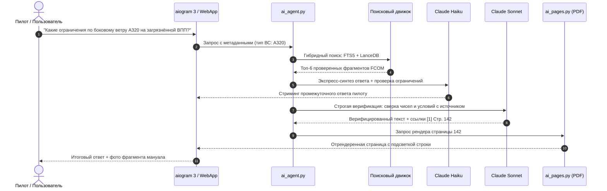

# Техническая архитектура и системный дизайн ANN (pilotann)

Этот документ содержит детальное инженерное описание архитектуры **ANN**, принципов работы гибридного RAG-поиска, межмодульного взаимодействия, стека библиотек и потоков данных между клиентами, базой данных и AI-моделями.

---

## 1. Общая топология и межмодульные связи

Система разделена на три взаимосвязанных слоя: **клиентские интерфейсы**, **асинхронный серверный шлюз** и **движок анализа данных (RAG & Aviation APIs)**.

---

## 2. Движок гибридного поиска (Hybrid RAG)

Авиационная техническая документация (FCOM, QRH, MEL) обладает специфическими характеристиками:
- Обилие точных кодов, аббревиатур и численных ограничений (`FL390`, `VMO 350`, `PACK 1 FAULT`).
- Семантические вопросы пилотов в свободной форме (*«что делать при отказе гидросистемы B на глиссаде»*).
- Высокие требования к нулевой погрешности галлюцинаций.

По этой причине ANN использует **двойную систему индексирования с алгоритмом Reciprocal Rank Fusion (RRF)**.

### 2.1. Лексический индекс (SQLite FTS5)
* **Технология**: Встроенное полнотекстовое расширение SQLite FTS5 с кастомным токенизатором.
* **Морфология**: Для русского языка подключён `snowballstemmer`, нормализующий окончания авиационных терминов без потери корня. Для английского языка применяется стемминг Портера.
* **Ранжирование**: Алгоритм BM25 с повышенными весами для заголовков разделов документа (`title`), ограничений (`limitations`) и процедурных шагов (`steps`).

### 2.2. Векторный семантический индекс (LanceDB)
* **Технология**: Высокопроизводительная колоночная векторная база данных [LanceDB](https://lancedb.com/), работающая без выделенного серверного демона поверх файлов Lance.
* **Модель эмбеддингов**: `intfloat/multilingual-e5-base` (768 измерений). Модель выбрана из-за сбалансированного качества русско-английского билингуального понимания авиационных контекстов.
* **Метрика расстояния**: Косинусное сходство (Cosine Similarity).

### 2.3. Алгоритм слияния рангов (RRF)
Результаты поиска из лексического и векторного индексов объединяются с помощью функции взаимного ранжирования:

$$RRF(d) = \sum_{m \in \{FTS, Vector\}} \frac{1}{k + r_m(d)}$$

где:
- $r_m(d)$ — порядковый ранг документа $d$ в списке результатов модели $m$ (начиная с 1).
- $k = 60$ — сглаживающая константа (предотвращает доминирование топового документа из одного списка над сбалансированным документом из обоих).

### 2.4. Cross-Encoder реранкинг (Reranker)
Топ-20 фрагментов, полученных после RRF-слияния, поступают на вход легковесного Cross-Encoder классификатора (или быстрого промпта Haiku), который выставляет каждому чанку точную оценку релевантности от `0` до `3`. Чанки с оценкой ниже пороговой отсекаются, освобождая контекстное окно модели для ключевых фактов.

---

## 3. Двухэтапная генерация и строгая верификация

1. **Классификация запроса**: Система автоматически извлекает:
   - Тип воздушного судна (A320, B737, SSJ100 и т.д.).
   - Эксплуатанта (если процедура специфична для конкретной авиакомпании).
   - Признак «Ограничения / Limitations» (переключает поиск в приоритетный режим раздел Limitations).
2. **Предварительный драфт (Fast Model — Claude Haiku)**:
   - Генерирует быстрый ответ для минимизации Time-To-First-Token (TTFT).
3. **Строгая сверка (Deep Verification — Claude Sonnet)**:
   - Проверяет каждое числовое значение, размерность (узлы, метры, футы, килограммы) и логические условия (*«IF ... THEN»*) строго по тексту найденных фрагментов.
   - Любое утверждение, отсутствующее в извлечённых чанках, удаляется из финального ответа.

---

## 4. Движок визуализации страниц (PDF Page Renderer)

ANN не просто даёт цитату, а визуально подтверждает её сканом оригинального документа:
1. Модуль `ai_pages.py` обращается к оригинальному PDF-файлу нужной редакции FCOM/QRH.
2. С помощью библиотеки `pypdfium2` (высокопроизводительный Python-биндинг к Google PDFium) страница мгновенно растеризуется в высоком разрешении.
3. Координаты найденного предложения сопоставляются с геометрическими границами (Bounding Boxes) текстового слоя страницы.
4. Библиотека `Pillow` накладывает аккуратную полупрозрачную маркерную подсветку цитируемой строки и генерирует оптимизированное превью для отправки в Telegram или отображения в WebApp.

---

## 5. WebApp, PWA и архитектура авторизации

Помимо классического диалога в Telegram, ANN предоставляет автономное веб-приложение:

* **Фронтенд**: Нативный JavaScript (ES2022), CSS-переменные с поддержкой тёмной/светлой авиационной темы, PWA Manifest и Service Worker (`sw.js`) для работы в офлайне и быстрого кэширования статики.
* **Картография**: На базе `MapLibre GL`, визуализирующая границы зон полётной информации (FIR), аэропорты и маршруты.
* **Безопасная мультиавторизация (`web_accounts.py`)**:
  - **Telegram WebApp**: верификация строки `initData` через криптографическую проверку HMAC-SHA256 с использованием bot token.
  - **Google OAuth / Apple ID**: валидация открытых ключей через JWKS и библиотеку `PyJWT[crypto]`.
  - **Email One-Time Passwords**: 6-значные одноразовые криптостойкие коды подтверждения с ограничением по частоте (Rate Limiting).
* **Уведомления**: Push-уведомления через протокол VAPID (RFC 8292) с шифрованием полезной нагрузки по стандарту Web Push.

---

## 6. Вспомогательные авиационные интеграции

* **METAR / TAF (`metar_decode.py`)**:
  - Токенизация сводок регулярной (METAR) и прогностической (TAF) погоды.
  - Автоматический расчёт компонентов бокового и встречного/попутного ветра относительно рабочих курсов полос аэропорта.
  - Декодирование сложной облачности (CB, TCU), явлений (FG, SN, TS, BLDU) и состояния полос (RVR, слой загрязнения, коэффициент сцепления).
* **SimBrief Parser (`simbrief.py`)**:
  - Загрузка оперативного плана полета (OFP) в формате XML/JSON по SimBrief Username.
  - Экстракция эшелона полёта (CRZ ALT), блока топлива, ZFW, запасных аэродромов, маршрута и ветровой обстановки по точкам маршрута.
* **OurAirports DB (`airports.py`)**:
  - Локальный географический индекс аэропортов мира: координаты, ICAO/IATA, превышение аэродрома, характеристики и длина ВПП, частоты связных радиостанций и ILS/VOR.

---

## 7. Полная матрица библиотек и зависимостей

| Библиотека | Назначение | Почему выбрана |
|---|---|---|
| **`aiogram>=3.4.0`** | Ядро Telegram-бота | Полностью асинхронный фреймворк с поддержкой Bot API 7.x, удобным роутингом, фильтрами и нативной поддержкой Telegram Mini Apps. |
| **`lancedb>=0.20`** | Векторная БД | Zero-infrastructure (работает как встроенная база без отдельного сервера), колоночный формат хранения Lance, исключительная скорость векторного поиска. |
| **`sentence-transformers>=2.4.0`** | Векторные эмбеддинги | Стандарт индустрии для запуска нейросетевых моделей эмбеддингов (`multilingual-e5-base`) локально на CPU/GPU. |
| **`snowballstemmer>=2.2`** | Морфологический стемминг | Высокая скорость нормализации слов для русского и английского языков в FTS-поиске без тяжеловесных зависимостей. |
| **`pypdfium2>=4.30`** | Рендеринг PDF | Высокоскоростной рендеринг страниц PDF на движке Google PDFium (в 5–10 раз быстрее poppler/pdf2image), низкое потребление RAM. |
| **`pillow>=10`** | Обработка изображений | Наложение графической подсветки (bounding box highlight) на страницы PDF, сжатие и конвертация в JPEG/WebP. |
| **`aiohttp>=3.9.0`** | Асинхронный HTTP сервер и клиент | Одновременное обслуживание REST API для Mini App, раздача статики и асинхронные HTTP-запросы к OpenRouter / SimBrief. |
| **`redis>=5.0.0`** | Кэш и FSM | Быстрое хранение состояний конечных автоматов (FSM) пользователей Telegram и блокировок от спама. |
| **`openai>=1.14.0`** | Клиент LLM | Официальный клиент для взаимодействия с OpenRouter / OpenAI-совместимыми эндпоинтами нейросетей. |
| **`PyJWT[crypto]>=2.8`** | Криптография авторизации | Валидация подписей RS256/ES256 для ID-токенов Google Sign-In и Sign in with Apple. |
| **`python-dotenv>=1.0.0`** | Управление окружением | Безопасная загрузка конфигураций и секретов из `.env`. |
| **`astral>=3.2`** | Астрономические расчёты | Расчёт времени восхода/заката солнца и сумерек для аэропортов маршрута. |
