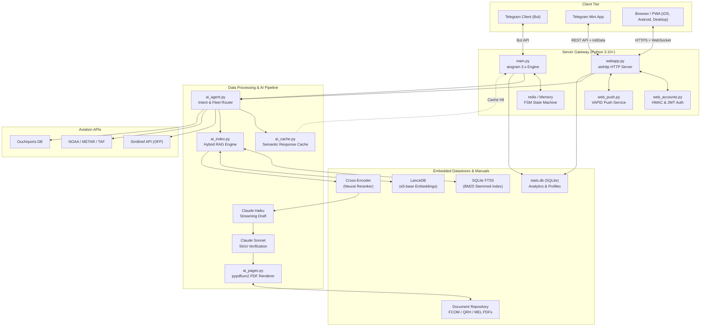
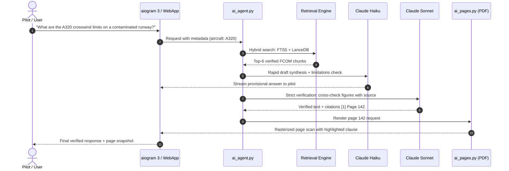

# ANN architecture

[ English | [Русский](ARCHITECTURE.ru.md) ]

How ANN is built: the modules and how they talk to each other, the hybrid RAG search, the libraries it depends on, and the path a question takes from the client through the local databases and the language models.

## 1. Modules

There are three independent layers: the clients, an async server gateway, and the data and AI pipeline.

## 2. Hybrid search

Flight manuals (FCOM, QRH, MEL) are full of exact codes, abbreviations and limits (`FL390`, `VMO 350`, `PACK 1 FAULT`), while pilots ask in plain language (*"procedure for hydraulic system B failure on final approach"*). A made-up limit or crosswind figure is not acceptable.

Keyword search handles the codes and vector search handles the plain language, so ANN runs both and merges the results with Reciprocal Rank Fusion (RRF).

### 2.1. Keyword index (SQLite FTS5)
The index uses the SQLite FTS5 extension with its own tokenizer and prefix indexing. Russian words are stemmed with `snowballstemmer`, English terms with the Porter stemmer. Ranking is BM25 with extra weight on section titles (`title`), limitations (`limitations`) and procedure steps (`steps`).

### 2.2. Vector index (LanceDB)
[LanceDB](https://lancedb.com/) is an embedded columnar vector database. It reads Lance datasets straight from disk, with no background server. Embeddings come from `intfloat/multilingual-e5-base` (768 dimensions), which handles English and Russian manuals about equally well. Distance is cosine similarity.

### 2.3. Reciprocal Rank Fusion (RRF)
The two result lists are merged by reciprocal rank:

$$RRF(d) = \sum_{m \in \{FTS, Vector\}} \frac{1}{k + r_m(d)}$$

Where:
- $r_m(d)$ is the ordinal rank of document $d$ in the output of retrieval channel $m$ (1-indexed).
- $k = 60$ is the usual smoothing constant. It keeps a single strong hit from one channel from pushing everything else out.

### 2.4. Reranking
A cross-encoder scores the top 20 passages after fusion from `0` to `3`. Passages below the threshold are dropped, so the model only sees the relevant ones.

## 3. Draft, then verification

1. The query is classified: aircraft type (A320, B737, SSJ100 and so on), operator-specific deviations and whether it concerns *Limitations*.
2. Claude Haiku starts streaming a draft right away, so the first words appear quickly.
3. Claude Sonnet then checks every number, every unit (knots, meters, feet, kilograms) and every condition (*"IF ... THEN"*) against the source text. Anything the retrieved passages don't support is cut.

## 4. Page citations

Each answer comes with the page it was taken from:
1. `ai_pages.py` opens the current PDF revision for the aircraft type.
2. `pypdfium2` (Python bindings to Google PDFium) renders the page at high resolution.
3. The coordinates of the quoted sentence are taken from the PDF text layer.
4. `Pillow` draws a semi-transparent highlight over that paragraph and saves a compressed JPEG or WebP for the client.

## 5. Web app, PWA and sign-in

Besides Telegram, ANN has its own progressive web app:

- The frontend is plain ES2022 JavaScript with light and dark themes built on CSS variables, a Web App Manifest and a service worker (`sw.js`) that caches assets for offline use.
- Maps use `MapLibre GL` to draw FIR boundaries, aerodromes and routes.
- Sign-in lives in `web_accounts.py`:
  - Telegram WebApp: the `initData` HMAC-SHA256 signature is checked with the bot token.
  - Google OAuth and Apple ID: tokens are checked against public keys from JWKS with `PyJWT[crypto]`.
  - Email: a random 6-digit one-time code, with sliding-window rate limits.
- Push notifications go out as Web Push with VAPID (RFC 8292) and encrypted payloads.

## 6. Aviation tools

- `metar_decode.py` parses METAR and TAF. It works out headwind, crosswind and tailwind from runway magnetic headings and reads cloud layers (CB, TCU) and runway condition reports (RVR, contaminant depth, braking action).
- `simbrief.py` parses SimBrief flight plans (OFP) in XML or JSON: cruise level (CRZ ALT), block fuel, zero-fuel weight (ZFW), alternates, route and winds at waypoints.
- `airports.py` is a local SQLite copy of the OurAirports database: ICAO and IATA codes, elevation, runways, frequencies and ILS/VOR aids.

## 7. Libraries

| Library | What it does | Why this one |
|---|---|---|
| `aiogram>=3.4.0` | Telegram Bot Core | Fully async, supports Bot API 7.x, FSM filters and Mini Apps. |
| `lancedb>=0.20` | Vector Database | Embedded, no server, fast vector search straight from disk in the Lance format. |
| `sentence-transformers>=2.4.0` | Dense Embeddings | The usual way to run `multilingual-e5-base` locally on CPU or GPU. |
| `snowballstemmer>=2.2` | Morphological Stemmer | Fast English and Russian stemming for FTS5 with no heavy dependencies. |
| `pypdfium2>=4.30` | PDF Engine | Built on Google PDFium, 5 to 10 times faster than poppler/pdf2image and light on memory. |
| `pillow>=10` | Graphic Compositing | Draws highlights by coordinates on page images and compresses them. |
| `aiohttp>=3.9.0` | Asynchronous Server | Serves the REST API and PWA files and makes async calls to the weather and SimBrief APIs. |
| `redis>=5.0.0` | Session & State Store | Keeps Telegram conversation state and rate limits. |
| `openai>=1.14.0` | LLM Gateway Client | One client for OpenRouter and any OpenAI-compatible endpoint. |
| `PyJWT[crypto]>=2.8` | Auth Cryptography | Checks RS256/ES256 signatures on Google and Apple sign-in tokens. |
| `python-dotenv>=1.0.0` | Configuration | Loads settings from `.env`. |
| `astral>=3.2` | Solar Ephemeris | Sunrise, sunset and civil twilight times at route waypoints. |
