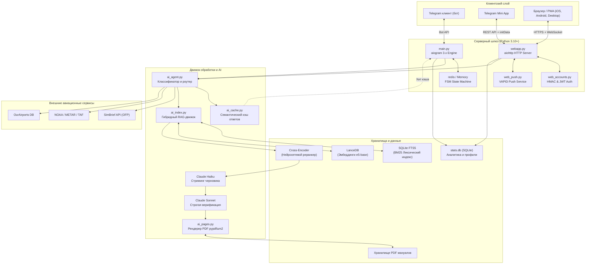
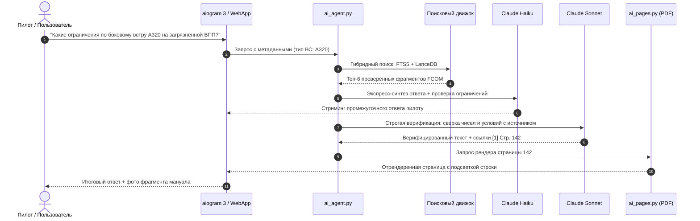

# Архитектура ANN

[ [English](ARCHITECTURE.md) | Русский ]

Как устроен ANN: из каких модулей он состоит и как они связаны, как работает гибридный RAG-поиск, на каких библиотеках все держится и какой путь проходит вопрос от клиента через базы данных и модели.

## 1. Модули и связи

Система разделена на три слоя: клиентские интерфейсы, асинхронный серверный шлюз и обработка данных (RAG и авиационные API).

## 2. Гибридный поиск

В FCOM, QRH и MEL полно точных кодов, аббревиатур и числовых ограничений (`FL390`, `VMO 350`, `PACK 1 FAULT`), а пилоты спрашивают своими словами (*«что делать при отказе гидросистемы B на глиссаде»*). Придуманное ограничение в ответе недопустимо.

Коды лучше ищет полнотекстовый индекс, смысл лучше ловит векторный, поэтому ANN использует оба и объединяет результаты алгоритмом Reciprocal Rank Fusion (RRF).

### 2.1. Полнотекстовый индекс (SQLite FTS5)

Индекс построен на расширении SQLite FTS5 со своим токенизатором. Для русского подключен `snowballstemmer`: он срезает окончания авиационных терминов и оставляет корень. Английские слова обрабатываются стеммером Портера. Ранжирование идет по BM25, причем заголовки разделов (`title`), ограничения (`limitations`) и шаги процедур (`steps`) весят больше.

### 2.2. Векторный индекс (LanceDB)

[LanceDB](https://lancedb.com/) это колоночная векторная база, которая работает прямо поверх файлов Lance, без отдельного серверного процесса. Эмбеддинги считает `intfloat/multilingual-e5-base` (768 измерений): она примерно одинаково хорошо понимает авиационные тексты на русском и английском. Близость измеряется косинусным сходством.

### 2.3. Слияние рангов (RRF)

Списки из двух индексов объединяются по формуле:

$$RRF(d) = \sum_{m \in \{FTS, Vector\}} \frac{1}{k + r_m(d)}$$

где:
- $r_m(d)$ — порядковый номер документа $d$ в выдаче индекса $m$ (счет с 1);
- $k = 60$ — сглаживающая константа. Без нее документ, который стоит первым только в одном списке, обгонял бы документ, найденный обоими.

### 2.4. Реранкинг

Первые 20 фрагментов после слияния проходят через легкий Cross-Encoder, и он ставит каждому оценку релевантности от `0` до `3`. Все, что ниже порога, отбрасывается, чтобы в контекст модели попали только нужные куски.

## 3. Черновик и проверка

1. Сначала из запроса извлекаются тип ВС (A320, B737, SSJ100 и т. д.), эксплуатант и признак того, что речь об ограничениях (*Limitations*).
2. Claude Haiku быстро пишет черновик, чтобы первые слова ответа появились почти сразу.
3. Claude Sonnet проверяет каждое число, единицы (узлы, метры, футы, килограммы) и условия (*«IF ... THEN»*) по тексту найденных фрагментов. Все, чего во фрагментах нет, из ответа удаляется.

## 4. Страницы PDF

Вместе с цитатой ANN показывает скан страницы, откуда она взята:
1. `ai_pages.py` открывает исходный PDF нужной редакции FCOM или QRH.
2. `pypdfium2` (Python-биндинг к Google PDFium) быстро растеризует страницу в высоком разрешении.
3. Координаты найденного предложения сопоставляются с рамками (bounding boxes) текстового слоя.
4. `Pillow` накладывает полупрозрачную подсветку на цитируемую строку и сохраняет сжатое превью для Telegram или веб-приложения.

## 5. Веб-приложение, PWA и авторизация

Кроме диалога в Telegram, у ANN есть отдельное веб-приложение:

- Фронтенд написан на чистом JavaScript (ES2022). Светлая и темная тема сделаны на CSS-переменных, есть PWA Manifest и Service Worker (`sw.js`), который кэширует статику и дает работать офлайн.
- Карты на `MapLibre GL` показывают границы районов полетной информации (FIR), аэропорты и маршруты.
- Вход реализован в `web_accounts.py`:
  - Telegram WebApp: подпись строки `initData` проверяется по HMAC-SHA256 с токеном бота.
  - Google OAuth и Apple ID: токены проверяются по открытым ключам из JWKS через `PyJWT[crypto]`.
  - Почта: одноразовый шестизначный код из криптостойкого генератора, число попыток ограничено.
- Push-уведомления идут через VAPID (RFC 8292), содержимое шифруется по стандарту Web Push.

## 6. Авиационные модули

- `metar_decode.py` разбирает METAR и TAF и считает боковую, встречную и попутную составляющие ветра для рабочих курсов полос. Он же декодирует облачность (CB, TCU), явления (FG, SN, TS, BLDU) и состояние ВПП (RVR, слой загрязнения, сцепление).
- `simbrief.py` загружает план полета (OFP) в XML или JSON по имени пользователя SimBrief и достает из него эшелон (CRZ ALT), топливо на блок, ZFW, запасные аэродромы, маршрут и ветер по точкам.
- `airports.py` хранит локальную базу аэропортов мира из OurAirports: координаты, коды ICAO и IATA, превышение, характеристики и длину ВПП, частоты и ILS/VOR.

## 7. Библиотеки

| Библиотека | Назначение | Почему выбрана |
|---|---|---|
| `aiogram>=3.4.0` | Ядро Telegram-бота | Полностью асинхронная, поддерживает Bot API 7.x, удобный роутинг, фильтры и Mini Apps. |
| `lancedb>=0.20` | Векторная БД | Встраивается в процесс без отдельного сервера, хранит данные в колоночном формате Lance, ищет очень быстро. |
| `sentence-transformers>=2.4.0` | Эмбеддинги | Обычный способ запускать `multilingual-e5-base` локально на CPU или GPU. |
| `snowballstemmer>=2.2` | Стемминг | Быстро нормализует русские и английские слова для FTS без тяжелых зависимостей. |
| `pypdfium2>=4.30` | Рендеринг PDF | Движок Google PDFium, в 5–10 раз быстрее poppler/pdf2image и мало ест памяти. |
| `pillow>=10` | Изображения | Рисует подсветку по координатам, сжимает и конвертирует в JPEG/WebP. |
| `aiohttp>=3.9.0` | HTTP-сервер и клиент | Обслуживает REST API для Mini App, раздает статику и асинхронно ходит в OpenRouter и SimBrief. |
| `redis>=5.0.0` | Кэш и FSM | Хранит состояния диалогов (FSM) пользователей Telegram и блокировки от спама. |
| `openai>=1.14.0` | Клиент LLM | Официальный клиент для OpenRouter и OpenAI-совместимых эндпоинтов. |
| `PyJWT[crypto]>=2.8` | Криптография входа | Проверяет подписи RS256/ES256 у ID-токенов Google и Apple. |
| `python-dotenv>=1.0.0` | Настройки | Загружает конфигурацию и секреты из `.env`. |
| `astral>=3.2` | Астрономия | Время восхода и заката солнца и сумерек для аэропортов маршрута. |
